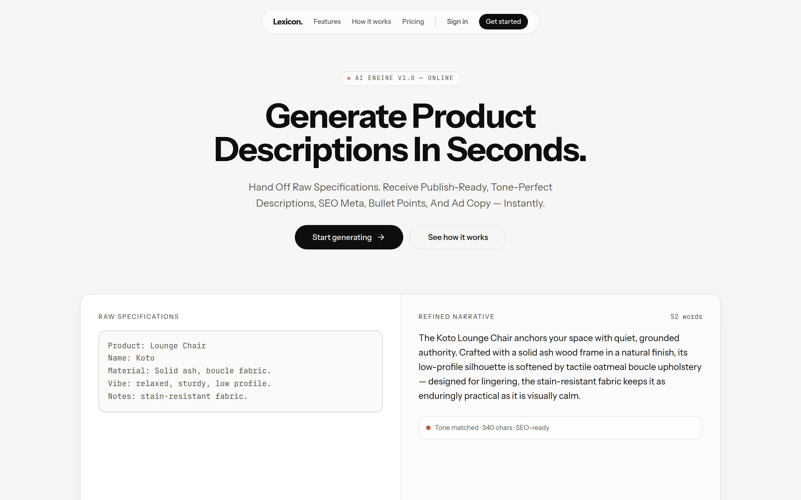
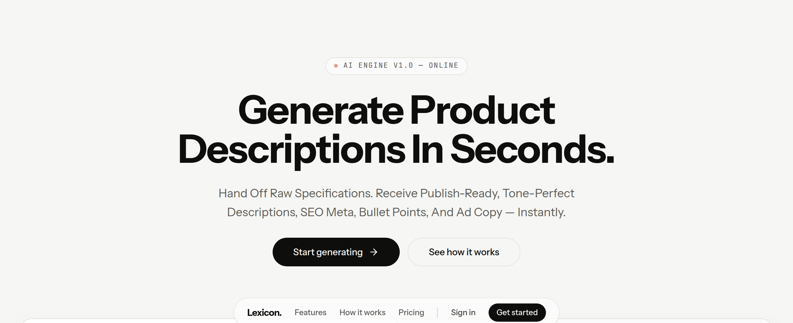
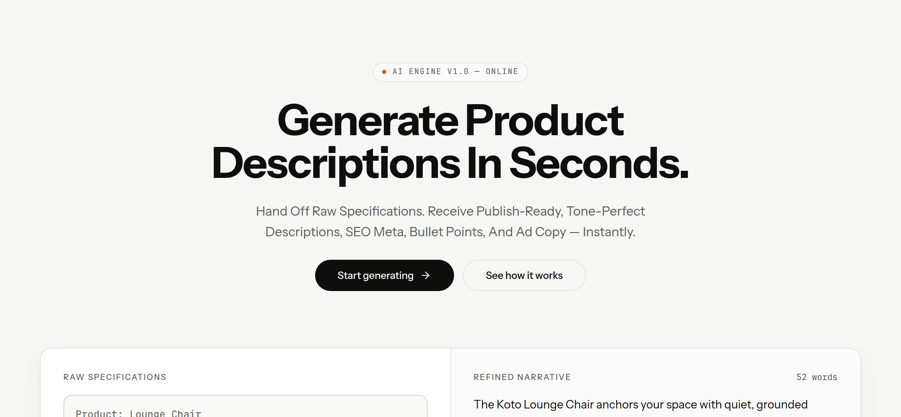
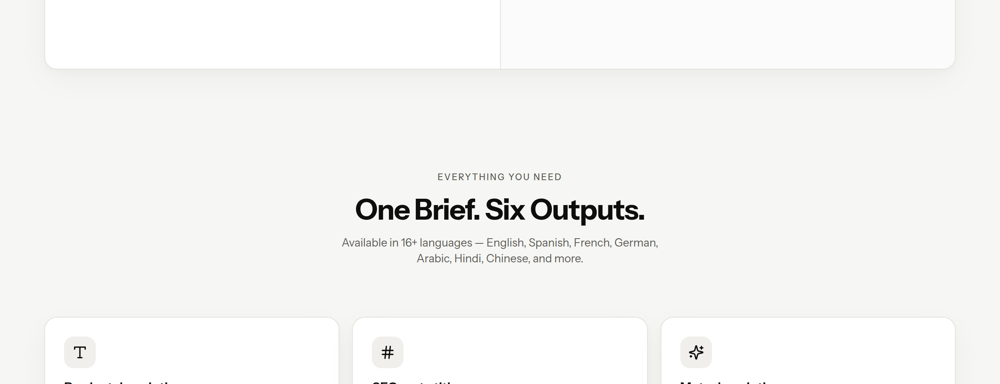
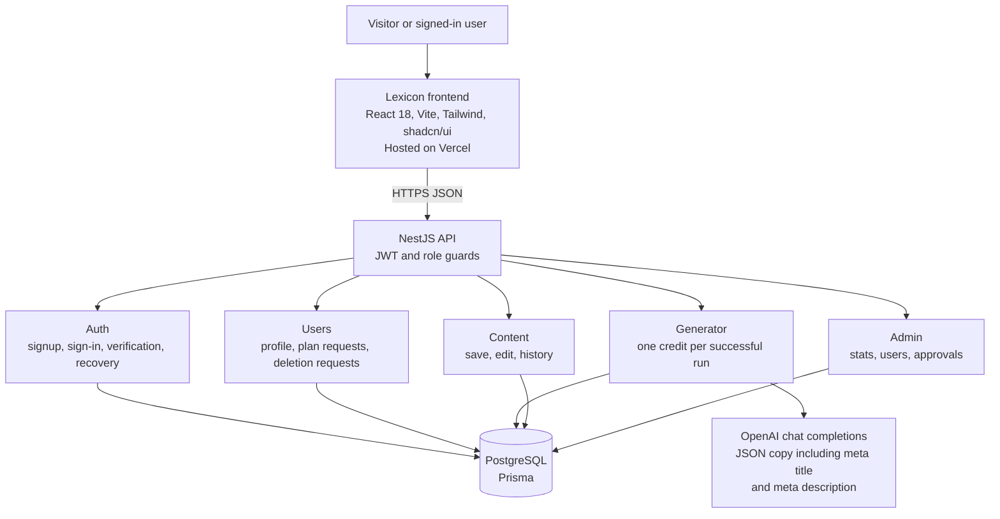

# Lexicon — AI SEO Content SaaS

Lexicon turns a product brief into publish-ready catalog copy: a description, highlights, an SEO meta title, an SEO meta description, ad copy, and a social caption. Teams spend credits as they generate, save the pieces they want, and admins approve plans from a control center.

## Live demo

The hosted app is at [https://ai-content-studio-liard.vercel.app](https://ai-content-studio-liard.vercel.app).

## Screenshots

Captured from the public live app. The workspace generator, dashboard, and admin portal are account-only, so they are not shown here.

### Landing

### Product preview

The landing page includes this brief-to-copy preview. It is the generator demo available without an account.

### Features

### Pricing

Public plans on the landing page. The in-app pricing screen also includes a Business tier.

## Features

Verified against this frontend and the NestJS API.

- **SEO meta titles and descriptions.** The generator returns six pieces of copy. Two of them are an SEO meta title and an SEO meta description, shown in the result panel and editable in the content editor. The API asks the model for `metaTitle` and `metaDescription` alongside the description, highlights, ad copy, and social caption.
- **Product briefs.** A run needs a product name and can include category, features, audience, tone, length, language, and keywords. Tones are Professional, Friendly, SEO-friendly, Luxury, and Simple. Lengths are Short, Medium, and Long. Sixteen languages are available, including English, Urdu, Roman Urdu, Arabic, Hindi, and Chinese (Simplified).
- **One credit per generation.** The API checks the balance, calls the model, stores the result, and decrements credits by one in the same transaction. Accounts with no credits left are blocked. Admin accounts cannot generate.
- **Credit-based plans.** The pricing page lists Free ($0), Starter ($19/month), Pro ($49/month), and Business ($149/month). Choosing a plan creates a pending subscription request. An admin approves or rejects it. Approval adds credits: 20 for Free, 250 for Starter, 1,000 for Pro, and 5,000 for Business. A new account is created with 250 credits.
- **User accounts.** Email signup, OTP verification, sign-in, and account recovery. Signed-in users get a dashboard, generator, saved library, history, templates, pricing, and settings, including an admin-reviewed deletion request. Copy can be edited, copied, and exported as `.txt` or `.doc`.
- **Admin portal.** Users with the `ADMIN` role land on the admin control center. Everyone else stays in the workspace, and the API repeats that check with a role guard. The portal shows user, generation, and credit stats, searchable accounts, a generation feed, and queues to approve or reject subscription and deletion requests.

## Architecture

The browser app in this repository talks to the NestJS API over HTTPS. Requests carry the signed-in user's access token. On startup the client calls the API health route so a sleeping host can wake before the first real request.

| Piece | Responsibility |
| --- | --- |
| Frontend | Marketing site, account screens, workspace, and admin UI. Hosted on Vercel. |
| Auth | Signup, sign-in, verification codes, and account recovery. Sign-in uses bcrypt hashes and Passport JWT. |
| Generator | Builds a copywriting prompt, requests JSON from OpenAI, and falls back to a short template if the model call fails. |
| Content | Lists, updates, and deletes a user's generations, including the saved library. |
| Users | Profile, subscription requests, and deletion requests. |
| Admin | Stats, user search, generation feed, and approve/reject actions. Guarded to the `ADMIN` role. |
| Data | PostgreSQL through Prisma: users, content, subscription requests, recovery codes, and deletion requests. |

## Backend

The API is its own NestJS repository: [ai-content-studio-backend](https://github.com/maarijwaseem2/ai-content-studio-backend). It stores accounts and generated copy, applies credit balances, and serves the admin API. This repository is the Lexicon web app.

## Tech stack

**Frontend (this repo)**

- React 18 and TypeScript
- Vite 5
- Tailwind CSS and shadcn/ui (Radix)
- React Router
- Zustand for session and library state
- Axios for the API client
- Vitest

**Backend ([ai-content-studio-backend](https://github.com/maarijwaseem2/ai-content-studio-backend))**

- NestJS 11
- Prisma and PostgreSQL
- Passport JWT and bcrypt
- OpenAI SDK

## Roadmap

- Pass length and keywords into the model prompt. The form already collects both and stores them with the brief.
- Deliver signup and account-recovery codes by email.
- Save profile and default tone and language from Settings through the API.
- Add self-serve checkout so plan upgrades do not wait on a manual approval.
- Apply every template preset. Luxury and Amazon listings already set the tone.

## Author

**Syed Abdul Maarij**

- GitHub: [maarijwaseem2](https://github.com/maarijwaseem2)
- LinkedIn: [linkedin.com/in/maarijwaseem2](https://linkedin.com/in/maarijwaseem2)
